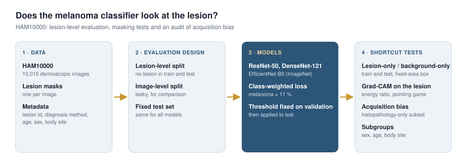

# Does the Melanoma Classifier Look at the Lesion?

Deep learning reports dermatologist-level accuracy for melanoma — but a model can also score well by learning what surrounds the lesion or how the image was taken. This project builds an evaluation on **HAM10000** designed to catch such shortcuts: lesion-level splits, lesion-only and background-only tests with a class-agnostic masking design, Grad-CAM measured against lesion masks, and an audit of the acquisition bias that links the diagnosis method to the diagnosis.

> **Status:** Work in progress — the pipeline is implemented and tested; results will be added once the HAM10000 experiments are completed.
> This repository presents the project and its design. **The source code is kept in a private repository** and can be shared on request.

## Why this project

Melanoma is the deadliest common skin cancer, and detecting it early decides survival. For an AI tool to help, its accuracy must come from the lesion itself. Earlier studies found models that react to surgical ink markings or still classify above chance when most of the lesion is hidden — scores that would not survive a new clinic, camera or protocol. HAM10000 adds two pitfalls of its own: many lesions appear in several images, and benign lesions documented by follow-up are acquired differently from histopathology-confirmed melanomas.

## What is inside

| | |
|---|---|
| **Data** | HAM10000: 10,015 dermoscopic images, 7 diagnoses, lesion masks, diagnosis method, age, sex, body site |
| **Evaluation design** | lesion-level split (no lesion in both training and test) vs the leaky image-level split · fixed test set |
| **Shortcut tests** | lesion-only / background-only test images · a model trained without ever seeing the lesion · fixed-area masking so lesion size cannot leak |
| **Explainability** | Grad-CAM energy on the lesion vs lesion area · pointing game |
| **Acquisition bias** | diagnosis × diagnosis-method audit · histopathology-only evaluation · follow-up vs histopathology probe among nevi |
| **Metrics** | AUROC · sensitivity at 90 % specificity · subgroups by sex, age and body site |
| **Networks** | ResNet-50 · DenseNet-121 · EfficientNet-B0 (ImageNet-pretrained) |

## Design

The full design — data, tasks, splits, masking logic, explainability, bias analyses, metrics and limitations — is in **[docs/DESIGN.md](docs/DESIGN.md)**.

## Results

Result tables will be published here when the experiments are completed.

| Setting | Test AUROC | Sens. @ 90 % spec. | Histopathology-only AUROC |
|---|---|---|---|
| Lesion-level split | _TBD_ | _TBD_ | _TBD_ |
| Image-level split (leaky) | _TBD_ | _TBD_ | _TBD_ |
| Trained on background only | _TBD_ | _TBD_ | _TBD_ |

## Tech stack

Python · PyTorch · torchvision · SciPy · pandas · Matplotlib · Google Colab (T4 GPU)

## Author

**Şule Özdamar** — Computer Engineering, İstanbul Arel University · [github.com/mahdildarr](https://github.com/mahdildarr)

Data: HAM10000 (Tschandl et al., 2018), lesion segmentations (Tschandl et al., 2020); CC BY-NC 4.0. The dataset is not redistributed here.
